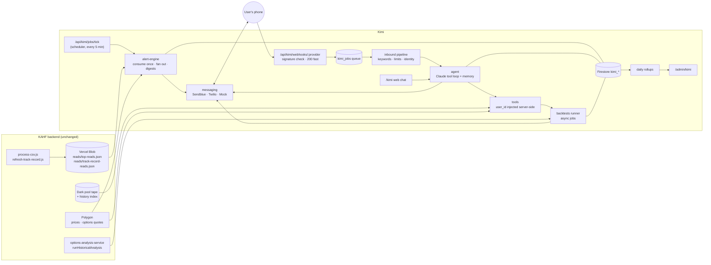

# Kimi by KAHF Capital

Kimi is a research assistant that lives in your texts. It does three things:

1. **Texts alerts** when the KAHF backend publishes a dark pool signal, filtered by each user's watchlist, quiet hours and caps.
2. **Answers follow-ups and runs backtests** over iMessage/SMS and in web chat on `/kimi`, using the same tools and the same conversation memory in both places.
3. **Reports usage** on `/admin/kimi`: funnel, retention, alert outcomes, backtests, conversations, users, system health and cost.

Kimi does no signal detection. Every alert is one backend signal, stored with its unmodified payload and keyed on the backend's signal id. Kimi never places trades and never sends order links. Everything it says is research, not advice.

The Phase 0 exploration, internal API map and gap list are in [PLAN.md](./PLAN.md).

---

## Architecture



**Alert path.** A scheduler calls `/api/kimi/jobs/tick`. The tick reads the backend's published signals, records each new signal id exactly once (`kimi_alerts`), fans it out through the delivery gates, sends the templated text, and makes the alert the user's thread context, so `MORE`, `BT` and "mute" resolve to it. The same tick sends due digests, records forward returns, retries due jobs, recovers stuck backtests and checks spend.

**Inbound path.** Provider webhooks verify the signature, store the job and return `200` immediately. The message is then processed in the background, with retries from the tick. Processing is idempotent on the provider message id. The pipeline handles reserved keywords before anything else (`STOP` always works), then the unknown-sender reply, rate limits and spend caps, then the agent.

**Agent.** The fast model (`KIMI_FAST_MODEL`) classifies intent in parallel with the main turn. The main model (`KIMI_MODEL`) runs a bounded tool loop: at most 6 iterations, a 25-second turn timeout and per-user daily token/cost caps. Every tool receives `user_id` from the server, never from the model. A rolling summary every 10 messages keeps long threads cheap. Texts get at most 2 messages per reply. Web chat gets longer answers.

**Backtests.** `BT` or "backtest X" sends an acknowledgement within a few seconds with a time estimate. The job then runs in the background against the existing backtest service and texts the top 3 structures with a link to `/kimi/backtests/:id`.

---

## Code map

| Path | What it is |
|---|---|
| `lib/kimi/kimi.config.js` | **Every limit, template, disclaimer, keyword and the system prompt.** Tune here. |
| `lib/kimi/alert-engine.js` | Signal consumption, retractions, delivery gates, templating, digests, forward returns |
| `lib/kimi/inbound.js`, `keywords.js`, `queue.js` | Webhook jobs, reserved keywords, durable queue (Firestore, or BullMQ when `REDIS_URL` is set) |
| `lib/kimi/agent.js`, `llm.js`, `tools.js` | Agent loop and memory, LLM provider interface, tool definitions |
| `lib/kimi/backtests.js`, `backend.js` | Backtest jobs and metrics; read-only adapters over the existing backend modules |
| `lib/kimi/messaging/` | `MessagingProvider` interface with Sendblue, Twilio and Mock adapters; the single outbound sender |
| `lib/kimi/store.js`, `db.js` | Repositories over Firestore, a dev JSON file, or memory (tests) |
| `lib/kimi/analytics.js`, `admin.js` | Dashboard queries, daily rollups, audit-logged admin actions |
| `lib/kimi/onboarding.js`, `crypto.js`, `auth.js` | OTP and consent, phone encryption/hashing/masking, auth guards |
| `pages/api/kimi/*`, `pages/api/admin/kimi/*` | API routes (webhooks, jobs, profile, chat, alerts, backtests, admin) |
| `pages/kimi/*`, `pages/k/[code].js`, `pages/admin/kimi/*` | Web pages and the short-link redirect |
| `src/pages/Kimi*.jsx`, `src/pages/admin/KimiAdmin*.jsx`, `src/components/kimi/*` | UI components |
| `scripts/kimi-seed.js`, `scripts/kimi-replay.js` | Dev seed data and the alert replay tool |
| `tests/kimi/*.test.mjs` | Unit and integration tests (`node:test`) |

---

## Environment variables

All variables are listed with comments in [`.env.example`](../../.env.example). These are the ones that matter for going live:

| Variable | Required | Notes |
|---|---|---|
| `MESSAGING_PROVIDER` | yes | `sendblue` (default; iMessage with SMS fallback) or `twilio` |
| `SENDBLUE_API_KEY`, `SENDBLUE_API_SECRET`, `SENDBLUE_FROM_NUMBER`, `SENDBLUE_WEBHOOK_SECRET` | with Sendblue | The webhook secret is the signing secret from Sendblue's webhook settings |
| `TWILIO_ACCOUNT_SID`, `TWILIO_AUTH_TOKEN`, `TWILIO_FROM_NUMBER` (or `TWILIO_PHONE_NUMBER`), `TWILIO_MESSAGING_SERVICE_SID` | with Twilio | Use the Messaging Service attached to your A2P 10DLC campaign |
| `ANTHROPIC_API_KEY`, `KIMI_MODEL`, `KIMI_FAST_MODEL` | yes | Defaults: `claude-sonnet-5-5`, `claude-haiku-5-5` |
| `KIMI_PHONE_ENCRYPTION_KEY` | yes (production) | 32 random bytes, base64 or hex. Kimi refuses to start phone operations in production without it. Don't change it after launch: existing phone numbers can't be decrypted with a new key. |
| `KIMI_DRY_RUN` | — | `true` logs every outbound message instead of sending. Start here. |
| `KIMI_ALERTS_ENABLED` | — | Master switch for proactive alerts. The admin kill switch overrides it to off instantly. |
| `KIMI_MAX_SIGNAL_AGE_MINUTES` | — | Default 15. Signals older than this when Kimi first sees them are stored as `stale`, not sent. |
| `KIMI_PUBLIC_BASE_URL` | yes | Base for links in texts and the webhook signature URL (e.g. `https://www.kahfcapital.com`) |
| `CRON_SECRET` or `KIMI_CRON_SECRET` | yes | Bearer token for `/api/kimi/jobs/tick` and `/api/kimi/jobs/rollup` |
| `ADMIN_EMAILS` | yes | Comma-separated logins allowed into `/admin/kimi` |
| Firebase Admin (`FIREBASE_SERVICE_ACCOUNT_BASE64` or `FIREBASE_ADMIN_*`) | yes | Already used by the site. Kimi stores everything in `kimi_*` collections. |
| `BLOB_READ_WRITE_TOKEN`, `POLYGON_API_KEY` | yes | Already used by the site: backend signals, the dark pool tape and market data |
| `REDIS_URL` | no | Uses BullMQ for the inbound queue (run `npm install bullmq`). Without it the queue lives in Firestore. |

Secrets stay on the server: none are referenced from client code, sent to the model, or written to logs.

---

## Local development

```bash
npm install
npm run kimi:seed      # 46 users, 8 weeks of activity -> data/kimi-dev-store.json (git-ignored)
npm run dev            # then open http://localhost:3000/kimi and /admin/kimi
npm run test:kimi      # unit + integration tests, no network
```

- **Storage.** Under `next dev`, Kimi uses `data/kimi-dev-store.json`, so local work never touches production Firestore. Set `KIMI_STORE=firestore` to use Firestore deliberately.
- **Identity.** In development, signed-out requests act as `dev_user`, and `/admin/kimi` is open. To browse as a seeded user, run `localStorage.setItem('kimi_dev_user', 'seed_user_05')` in the browser console and reload. Production builds ignore these dev headers. Set `KIMI_DEV_AUTH=false` to turn them off locally too.
- **No texts locally.** Keep `KIMI_DRY_RUN=true`. Onboarding shows the verification code on screen instead of texting it, and every outbound message is logged to the transcript with `dry_run: true`.
- **Simulate an inbound text** (mock provider, development only). Set `KIMI_MOCK_WEBHOOK_SECRET=dev-secret` in `.env.local`, then:

  ```bash
  curl -X POST http://localhost:3000/api/kimi/webhooks/mock \
    -H "content-type: application/json" -H "x-kimi-mock-signature: dev-secret" \
    -d '{"providerMessageId":"test-1","from":"+14155550100","text":"what is the latest on $NVDA?"}'
  ```

  The `from` number must belong to a verified profile: onboard it on `/kimi` first, or use a seeded user's number. Read the reply in the web chat or in the admin transcript.
- **Run the alert tick by hand.** `curl -X POST http://localhost:3000/api/kimi/jobs/tick`. In development no secret is needed. Alerts only fan out with `KIMI_ALERTS_ENABLED=true`, and in dry run nothing is sent either way.

---

## Going live (steps only you can do)

1. **Set production env vars in Vercel:** `KIMI_PHONE_ENCRYPTION_KEY`, `KIMI_PUBLIC_BASE_URL`, `CRON_SECRET`, `ADMIN_EMAILS`, the messaging provider credentials and `ANTHROPIC_API_KEY`. Keep `KIMI_DRY_RUN=true` and `KIMI_ALERTS_ENABLED=false` for the first deploy.
2. **Point the provider's inbound webhook at Kimi:**
   - Sendblue: set the receive webhook to `https://<your-domain>/api/kimi/webhooks/sendblue` and copy its signing secret into `SENDBLUE_WEBHOOK_SECRET`.
   - Twilio: on the number or Messaging Service, set "A message comes in" to `https://<your-domain>/api/kimi/webhooks/twilio` (HTTP POST). Twilio signs requests with your auth token. `KIMI_PUBLIC_BASE_URL` must match the public URL exactly, or signatures fail.
   - Delivery status callbacks are attached per message automatically. Each callback URL carries a signed token.
3. **Schedule the tick.** `POST /api/kimi/jobs/tick` with `Authorization: Bearer <CRON_SECRET>`, every 5 minutes. Choose one:
   - **Vercel Pro:** add a cron to `vercel.json`:
     ```json
     "crons": [
       { "path": "/api/kimi/jobs/tick", "schedule": "*/5 * * * *" },
       { "path": "/api/kimi/jobs/rollup", "schedule": "15 6 * * *" }
     ]
     ```
     Vercel sends `CRON_SECRET` automatically. The Hobby plan only allows daily crons, and a deploy with a 5-minute cron fails on Hobby.
   - **External scheduler** (cron-job.org, Upstash QStash, or any uptime pinger that can send a header): POST the tick URL with the bearer header every 5 minutes.
   - If the scheduler runs less often than every 5 minutes, raise `KIMI_MAX_SIGNAL_AGE_MINUTES`. Otherwise fresh signals can age past the limit before Kimi sees them.
   - The daily rollup job is optional: the dashboard builds any missing days on demand.
4. **US SMS through Twilio needs A2P 10DLC registration.** Register a brand and a campaign in the Twilio console and attach your number to that campaign's Messaging Service. The campaign needs:
   - the opt-in description (the `/kimi` checkbox with the consent text from `kimi.config.js`)
   - sample messages (the alert template and the welcome text)
   - the HELP and STOP responses
   Until the campaign is approved, carriers filter or block the traffic. Toll-free verification is the alternative. Sendblue handles iMessage onboarding on its side.
5. **Have counsel review the consent and disclaimer wording** (`consent`, `disclaimers` and `templates` in `kimi.config.js`). If you change the consent text, bump `consent.version`: new verifications record the new version, and each profile keeps the version and exact text that user agreed to (shown on the admin user page).
6. **Dry-run in production.** With `KIMI_DRY_RUN=true`, onboard yourself and turn alerts on. Every message Kimi would have sent appears in the admin transcript, and nothing goes out.
7. **Go live.** Set `KIMI_DRY_RUN=false`, then `KIMI_ALERTS_ENABLED=true`. The **Alerts** kill switch on `/admin/kimi` turns proactive alerts off within one tick, without a deploy.
8. **Firestore indexes.** Kimi's queries fall back to in-memory sorting when a composite index is missing, which is fine at small scale. If the logs show `FAILED_PRECONDITION ... requires an index`, open the link in the error to create it.

---

## How alerts work

**Source.** `reads/top-reads.json` (latest session) and `reads/track-record-reads.json` (history) from Vercel Blob, falling back to the bundled copies in the repo. These are the files the backend's `refresh-track-record.js` publishes. The signal id is the backend's own key, `TICKER__YYYY-MM-DD`, and `found_at` is when the backend published it.

**Exactly once.** Each signal id is created once in `kimi_alerts`, with an atomic create. Repeat polls, retries and concurrent ticks can't send it twice. Each delivery is also created once per `alert__user`.

**Late, stale and retracted signals.**
- A signal first seen more than `KIMI_MAX_SIGNAL_AGE_MINUTES` after `found_at` is stored as `stale` and not sent.
- Signals more than 7 days old are recorded as backfill, so the first deploy never sends history.
- A signal is retracted when the backend excludes the ticker, when it fails the backend's publish-session rule, or when it disappears from the history feed after publication. Queued digests drop it.
- A guard skips retraction when more than half of the active alerts would vanish at once, which protects against a truncated feed.

**Delivery gates, in order.** Each skip is recorded with a reason code and shows up on the Alerts tab.

| # | Gate | Reason code |
|---|---|---|
| 1 | Watchlist: tickers, sectors (SIC lookup, cached), or all; muted tickers | `watchlist_miss`, `muted` |
| 2 | Minimum notional (a personal filter on the backend's notional, not a signal rule) | `min_notional` |
| 3 | Paused | `paused` |
| 4 | Opted out | `opted_out` |
| 5 | Quiet hours in the user's timezone (DST-aware) | `quiet_hours` |
| 6 | Market hours only (NYSE hours and holidays, ET) | `market_hours` |
| 7 | Same ticker within 2 hours | `dedupe` |
| 8 | Caps: 2 per rolling hour, N per local day (default 5) | `cap` (window: `hour` or `day`) |
| 9 | Digest mode: bundle into one text per interval | `queued_digest` → sent as one text |

The kill switch (`kill_switch`), dry run and opt-out are enforced again in the sender itself. No code path can text a user who replied STOP.

**Template.** `alertTemplate` in `kimi.config.js` maps placeholders to backend payload fields. Optional `[...]` segments are dropped when their field is missing, and Kimi never computes a value the backend didn't provide. Example from current data:

> Kimi: $CSX dark pool print ($630M) on Oct 22, avg $51.57. Volume 3.0x the 7-day average. KAHF read: ATM straddle $52 exp Nov 20 at $2.69, 64% hist. hit rate. Reply MORE for details or BT to backtest this setup. https://www.kahfcapital.com/k/GVtDB9t

**Forward returns.** The tick records the close on the signal day, T+1 and T+5 trading days, from the same Polygon price data the backend uses. The Alerts tab shows them next to engagement.

---

## Tuning delivery (not signals)

Signal parameters (volume-ratio threshold, lookback, scoring, exclusions) live in the backend: `scripts/build-top-reads.js`, `scripts/refresh-track-record.js` and `lib/read-filters.js`. Kimi doesn't change them. What you can tune in Kimi is **delivery**:

- Defaults: `delivery` in `lib/kimi/kimi.config.js` (hourly and daily caps, dedupe window, quiet hours, digest interval, market hours and holidays, staleness, backfill age).
- Per user: watchlist, minimum notional, quiet hours, timezone, market-hours-only, max per day, digest and pause. Users set these on `/kimi` or by text ("only NVDA and AMD", "quiet after 9pm", "max 3 a day", "mute $TSLA").

Use the replay tool to see what a change would do before shipping it. It replays the backend's real historical signals through the alert engine against your current users (or sample personas), in an isolated in-memory store with dry run forced on. Nothing is sent and nothing is written.

```bash
npm run kimi:replay -- --since 2026-09-01
npm run kimi:replay -- --since 2026-09-01 --max-per-day 3 --digest 30 --verbose
npm run kimi:replay -- --users sample --quiet 21:00-08:00 --dedupe-minutes 240 --json replay.json
```

Options: `--since`, `--until`, `--ticker`, `--users store|sample`, `--max-per-day`, `--max-per-hour`, `--dedupe-minutes`, `--digest N|off`, `--quiet HH:MM-HH:MM|off`, `--market-hours-only`, `--min-notional`, `--verbose`, `--json FILE`.

The output lists each signal with the rendered text and counts of sent, digest and suppressed by reason, then totals and a per-user breakdown (masked phones only). Two observations from the current backend data:

- **The backend publishes after the close** (about 5 PM ET), so users with *market hours only* turned on currently receive nothing.
- **Signals cluster:** several often publish in the same minute, so the 2-per-hour cap suppresses the rest. Digest mode delivers all of them in one text.

---

## Backtests

- **Engine:** the existing `runHistoricalAnalysis` in `lib/options-analysis-service.js`, unchanged, for `call`, `put` and `straddle`, with the live ATM premium from `getOptionsQuote`. "Backtest this" on an alert uses the signal's own structure, strike, expiry and premium, with history capped at the signal date.
- **Metrics shown honestly.**
  - Win rate and trade count come straight from the backend.
  - Average return, max drawdown and Sharpe are derived by Kimi from the same historical windows the backend uses (hold to expiry at the quoted premium). Kimi shows them only if its own trade and win counts reproduce the backend's `totalSamples` and `totalProfitable` exactly. Otherwise it shows only what the backend returned.
  - Results with fewer than 30 trades are flagged as small samples. Every result carries the hypothetical-performance disclaimer.
- **Ranking:** by Sharpe by default; users can ask for win rate, average return or drawdown.
- **Limits:** 15 per user per day, 2 running at once, plus the per-user daily token/cost cap. A stuck job fails after 10 minutes and the user gets a text.

---

## Text commands

| Text | Effect |
|---|---|
| `STOP`, `STOPALL`, `UNSUBSCRIBE`, `CANCEL`, `END`, `QUIT` | Opt out immediately; one confirmation, then nothing |
| `START`, `UNSTOP` | Opt back in |
| `HELP` | Help text with support contact and how to stop |
| `PAUSE` / `RESUME` | Pause alerts for 24 hours / resume |
| `MORE` | Details on the last alert, from backend data |
| `BT` | Backtest the last alert |
| Anything else | Kimi answers with tools: prints, quotes, backtests, comparisons, settings |

Unknown numbers get one signup-link reply per 24 hours and nothing else.

---

## Data, privacy and compliance

- **Consent:** the exact consent text, its version, the timestamp, IP address and user agent are stored on the profile when the user checks the box. The welcome text includes the program name, frequency, "Msg & data rates may apply", HELP/STOP and the disclaimer.
- **Messages are immutable:** create-only, with `retain_until` set from `KIMI_MESSAGE_RETENTION_DAYS` (default 7 years). No app code deletes them. Admins can export a user's full message log as CSV for compliance requests.
- **Phones:** AES-256-GCM encryption at rest, an HMAC hash for lookups and masking everywhere in the UI (`+1 ••• •••-4821`). Verification codes are never stored in the message log.
- **Admin access:** limited to `ADMIN_EMAILS`. Every transcript view and export is written to `kimi_audit_log` before data is returned.
- **What the model sees:** the user's messages, preferences, recent alerts and tool results. Tool output is passed to the model as data, not instructions. The model never sees phone numbers or secrets.

## Security notes

- Webhooks are rejected without a valid signature: Sendblue's signing secret, Twilio's `X-Twilio-Signature`, or a signed per-message token on status callbacks. Duplicate deliveries are ignored by provider message id.
- Rate limits per user (8/min, 60/hour inbound), per phone for verification codes, and per user for backtests. Per-user daily token and cost caps, plus a global daily spend alert.
- Tools authorize on the server: every lookup is scoped to the session's `user_id`, and requests for another user's alert or backtest return "not found".
- Admin and cron endpoints fail closed in production.

## Admin dashboard

`/admin/kimi` has seven tabs (Overview, Funnel & retention, Alerts, Backtests, Conversations, Users, System health & cost). The global filters (date range, channel, plan, ticker) apply to every tab. Every KPI is compared with the previous period of equal length, except point-in-time readings such as queue depth, which are labeled "live now". Every table exports to CSV.

- **Data sources:** charts read daily rollups (`kimi_daily_rollups`, keyed by channel, plan and ticker); KPIs and tables read raw records.
- **Rollups** are rebuilt nightly by `/api/kimi/jobs/rollup`, rebuilt on demand for today and yesterday, built on demand for any missing day, and can be rebuilt for a range from the Health tab.
- **User pages** show the timeline, preferences, consent record, an audit-logged transcript and a compliance export.
- **Header switches:** the alerts kill switch and the dry-run toggle. Every change is audit-logged. The dashboard can force dry run on at any time, but it can't turn off a dry run that `KIMI_DRY_RUN=true` sets.

## Known gaps

See [PLAN.md → Gaps](./PLAN.md#4-gaps-found-and-how-kimi-handles-them). In short:

- The backtest API can't condition entries on past signals.
- The signal payload has no intraday print time or price reaction.
- The backend doesn't always record a parameter version.
- The backend has no push stream, so Kimi polls.
- The quote tool returns the previous close.

## Tests

`npm run test:kimi` runs the suite in `tests/kimi/`. It covers:

- signal consumption, exactly-once, retractions and staleness
- template rendering with missing fields
- every delivery gate, including quiet hours across timezones and DST, caps, dedupe and digests
- reserved keywords
- webhook signatures and idempotency
- onboarding (verification codes, consent, number ownership)
- tool ownership checks
- backtest metrics and limits
- audit logging, short links, delivery receipts and rollups
- an end-to-end text → tool → reply flow with a mocked provider and LLM
